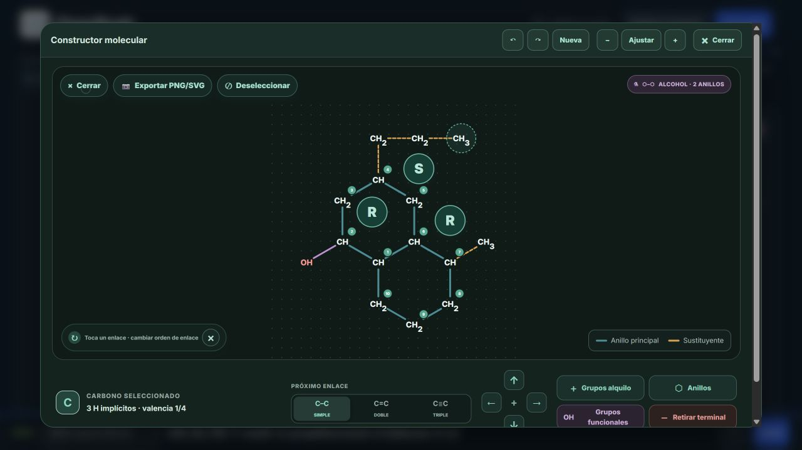

# FEAT-SEMI-STEREO-001 — R/S informativo en semidesarrollada

Fecha: 2026-10-20. Rama: `main`.
HEAD inicial y final: `03541a59491cd19d68b8ab5b5a439b54b0f87d8b`.

**Resultado:** implementadas las opciones Ocultar y Mostrar R/S, con Mostrar como preferencia predeterminada subordinada al ajuste global. **59 PASS / 0 FAIL / 0 SKIP** en las pruebas dirigidas. Build y validación Pages aprobados. Se realizaron comprobaciones reales de navegador y exportación, no solo fixtures estáticas.

**Modo avanzado:** no implementado; su opción está deshabilitada con explicación ES/EN, conforme a la alternativa de seguridad de la solicitud. No se afirma soporte de cuñas/rayados semidesarrollados. La matriz visual se verificó por escenarios seleccionados, no por todas las combinaciones posibles.

## 1. Diagnóstico y punto de partida

Antes de intervenir se comprobaron rama, HEAD y `git status --short`. FIX-SEMI-FUSED-001 ya estaba integrado en HEAD; su algoritmo no se reescribió ni modificó. Solo existían estos archivos ajenos sin seguimiento:

```text
reports/orgorush-aud001-repair.md
tatus --short
```

La condición `viewMode === "skeletal" && stereochemistryEnabled` restringía `getTetrahedralStereoBonds()` a esquelética. Los badges existentes se dibujaban dentro de esa ruta de enlaces, de modo que semidesarrollada no tenía una fuente independiente de indicadores. La configuración absoluta seguía almacenada.

`getTetrahedralStereoCenters()` ya valida mediante OpenChemLib los centros asignados. `layoutTetrahedralBadgePositions()` ya coloca círculos considerando etiquetas y numeración, pero exigía un vecino portador y no penalizaba atravesar enlaces. Se reutilizan ambos mecanismos; no se añade un algoritmo CIP.

«Recordar estereoquímica» controla el estado global `showStereochemistry`, con almacenamiento propio. La visibilidad efectiva existente es `showStereochemistry && !simplifiedModeEnabled`. La nueva preferencia no modifica esa semántica ni los nombres, las acciones R/S o las otras vistas.

## 2. Implementación

### Preferencia de presentación

Nuevo módulo `app/semi-developed-stereo.ts`:

- Clave: `hydrocarbonLab.semiDevelopedStereoDisplay.v1`.
- Valores disponibles: `hidden` y `labels`; predeterminado `labels`.
- Valores ausentes, corruptos, desconocidos o el avanzado no disponible `labels-and-bonds` recuperan `labels`.
- Lectura/escritura toleran almacenamiento ausente o bloqueado. No se accede a `window` durante la importación del módulo ni el render inicial.
- `app/page.tsx` usa el patrón existente de restauración diferida y bandera de preparación, evitando sobrescribir la preferencia antes de leerla.
- El modo aislado de editor conserva el patrón existente de no leer/escribir preferencias del editor principal.
- La preferencia es independiente de idioma y molécula. No se añade a SMILES, documentos portables ni historial químico.
- Incluye un botón Restablecer propio. El reinicio de posiciones de paneles no se convierte en un reinicio general de ajustes.

### Selección de centros

`getSemiDevelopedStereoCenters()` consulta `getTetrahedralStereoCenters(molecule)` únicamente en semidesarrollada, con ajuste global activo y preferencia `labels`. No usa localizadores ni índices de recorrido para identificar centros. No depende de `tetrahedralBondTo` para mostrar una etiqueta.

Ocultar o apagar la visualización global devuelve una lista vacía sin mutar el modelo. La preferencia específica se conserva al apagar el ajuste global. Al reactivarlo aparecen los mismos centros válidos.

### Posicionamiento y límites

Se extiende de manera compatible **solo la función de presentación** `layoutTetrahedralBadgePositions()` dentro de `app/tetrahedral-stereochemistry.ts`:

- Acepta centros con vecino opcional para badges informativos.
- La opción adicional de evitar enlaces activa 24 direcciones y seis distancias acotadas de 1 a 3 veces la distancia base, 48 unidades multiplicadas por la escala.
- Considera los rectángulos de CH, CH₂, CH₃, heteroátomos/grupos funcionales y numeración que el editor ya calcula; también los badges colocados previamente y la distancia a todos los segmentos de enlace. Usar el segmento completo es conservador respecto a su porción visible recortada.
- La elección es determinista y no desplaza átomos, modifica coordenadas químicas ni cambia enlaces.
- Las llamadas esqueléticas sin la opción nueva mantienen las direcciones, distancias y puntuación anteriores.
- Se reutilizan las dos pasadas existentes de escala y colocación. Los nuevos círculos entran en `tetrahedralBadgeExtents`, `visualExtents`, autoajuste normal, canvas ampliado y `getSemiDevelopedBounds()`; los límites se calculan incluyendo los badges, en vez de recortarlos al marco anterior.

La búsqueda acotada no es un solucionador general de empaquetado para cualquier grafo arbitrariamente congestionado. Las geometrías probadas abajo encuentran colocaciones libres. No se afirma una garantía universal fuera de esa cobertura; estructuras mucho más densas requieren revisión visual adicional.

No se cambió `app/semi-developed-layout.ts`. Los polígonos fusionados conservan exactamente el layout corregido previamente.

### SVG, estilo y accesibilidad

`SemiDevelopedStereoBadgeSvg` reutiliza círculos, tipografía, colores y estilos oscuros de los badges existentes. Es **informativo**: `role="img"`, título y nombre accesible; no tiene `role="button"`, tab stop, hit target ni manejador para invertir configuraciones. El cursor es normal y el badge no captura puntero.

Cada elemento incluye `data-stereo-atom-id` con el ID químico. El texto procede de la configuración validada. Para carbonos con localizador válido se usa, por ejemplo, «Carbono 2, configuración R» / «Carbon 2, R configuration». En ausencia de referencia válida —o para un centro no carbonado— se usa «Átomo ID …» / «Atom ID …».

Los controles y la explicación nueva tienen traducción ES/EN. No se emprendió una revisión de cadenas preexistentes de otras partes de la interfaz.

### Modo avanzado

Se presenta la tercera opción solicitada, pero deshabilitada. El texto explica que deben validarse la geometría y el recorte de etiquetas antes de ofrecer cuñas/rayados en semidesarrollada.

La esquelética conserva su ruta de `getTetrahedralStereoBonds()` y sus acciones existentes. El nuevo modo informativo nunca sustituye trazos moleculares por cuñas. No se hacen reparaciones químicas ni cambios a CIP para habilitar el modo avanzado.

### Exportación

Los badges informativos son parte del contenido visible exportable, sin `data-editor-only`. El pipeline existente clona el SVG, incorpora estilos, elimina hit targets y ajusta límites; no fue modificado. La selección `hidden` elimina los badges también de la exportación.

Se descargaron realmente PNG y SVG con tres badges y SVG ocultándolos. La vista previa exportable tenía **3 badges y 0 hit targets** en Mostrar; **0 y 0** en Ocultar. La identidad química permanece independiente de esas imágenes.

## 3. Integridad química y regresiones

La prueba permanente nueva es `tests/feat-semi-stereo-001.test.mjs`, con nueve casos que agrupan los escenarios solicitados:

- Molécula aquiral, centro potencial sin configurar y configuración inválida: cero badges afirmativos.
- Centros R y S importados realmente: etiqueta correcta asociada al ID real.
- Badge sin `tetrahedralBondTo`; render TSX real, sin interactividad fingida.
- Tres centros válidos en el alcohol bicíclico: C2 R, C4 S y C7 R.
- Ocultar, apagar globalmente, reactivar y alternar vistas sin mutaciones.
- Modificación que vuelve aquiral el centro: el saneamiento existente elimina la configuración y no queda badge obsoleto; la consulta también rechaza el descriptor inválido sin sanear.
- Persistencia, valores corruptos, almacenamiento bloqueado y ausencia de almacenamiento.
- Textos y etiquetas accesibles ES/EN, localizadores y fallback a ID.
- Integración del componente, autoajuste y tercera opción deshabilitada.

La prueba geométrica recorre reflexión, escalas de etiquetas 75/125/175% y escalas geométricas de badges 0.75/1/2/3, incluyendo contrascala. Exige separación de rectángulos, enlaces y otros badges; posiciones finitas y deterministas; círculos enteros dentro de los límites que los incluyen.

Se compara profundamente el grafo antes/después —átomos, IDs, coordenadas fuente, cargas, enlaces/órdenes, anillos, paridad y portadores—, además de centros reconocidos, fórmula `C14H26O`, SMILES estereoquímico, portadores y coordenadas deterministas al alternar vistas. El nuevo estado nunca modifica el modelo; por tanto no cambia valencias, aromaticidad o hidrógenos implícitos derivados del mismo grafo.

Las 20 pruebas de FIX-SEMI-FUSED-001 siguen aprobando: 5+5, ambas orientaciones 5+6/6+5, 6+6, tres anillos, alcohol sustituido, inversión de registros, IDs remapeados, etiquetas rasterizadas y decodificación de cuñas conservando R/S. No se modificó ninguna prueba anterior para hacerla pasar.

## 4. Validación automatizada reproducible

Todos los procesos Node tuvieron límite externo de **85 s**, con `Start-Process`, `WaitForExit(85000)` y `Kill($true)` del árbol si se alcanzaba el límite. Los tiempos indicados son de pared medidos con `Stopwatch`.

| Comando | Pared | PASS / FAIL / SKIP |
| --- | --- | --- |
| `node --test tests/feat-semi-stereo-001.test.mjs` (final) | 2.835 s | 9 / 0 / 0 |
| `node --test --test-concurrency=1 tests/tetrahedral-stereochemistry.test.mjs tests/tetrahedral-badge-scale.test.mjs tests/semi-developed-renderer.test.mjs tests/semi-developed-label-scale.test.mjs tests/browser-global-and-png-export.test.mjs` | 18.360 s | 30 / 0 / 0 |
| `node --test tests/fix-semi-fused-001-layout.test.mjs` | 19.773 s | 20 / 0 / 0 |
| `npm run build:pages` (final) | 5.560 s | Salida 0 |
| `npm run validate:pages` (final) | 0.837 s | Salida 0: 3 entradas, 6 assets, base `/Hydrocarbon-Lab/` |
| `git diff --check` | Sin cronometraje separado | Salida 0 |

**Total de pruebas únicas: 59 PASS / 0 FAIL / 0 SKIP. Timeouts de pruebas: 0.**

La prueba nueva también se ejecutó al implementar, con 9/0/0 en 2.658 s. Se repitió tras el ajuste final de referencias accesibles de carbonos y limpieza de CSS. El primer build aprobó en 6.448 s y la primera validación Pages en 0.811 s; no se suman estas repeticiones al total de pruebas.

`node reports/feat-semi-stereo-001-evidence/fixture.mjs` se ejecutó en 1.493 s, salida 0, para obtener la fixture reproducible.

Advertencias del build: importación simultáneamente estática/dinámica del adaptador OpenChemLib, chunks mayores de 500 kB y aviso informativo de tiempo en plugins. No son fallos de compilación. Git avisa de normalización futura LF→CRLF en CSS/TSX; `diff --check` no detecta errores de whitespace.

No se ejecutaron `npm test`, el patrón global `tests/*.test.mjs`, auditorías masivas, suites completas de Practice/Exam ni baterías extensas de UI. No se instalaron dependencias nuevas.

### Ejemplo del límite externo

```powershell
$out = Join-Path $env:TEMP ('semistereo-' + [guid]::NewGuid().ToString('N') + '.out')
$err = Join-Path $env:TEMP ('semistereo-' + [guid]::NewGuid().ToString('N') + '.err')
$timer = [Diagnostics.Stopwatch]::StartNew()
$p = Start-Process node -ArgumentList @('--test', 'tests/feat-semi-stereo-001.test.mjs') -PassThru -NoNewWindow -RedirectStandardOutput $out -RedirectStandardError $err
$timedOut = -not $p.WaitForExit(85000)
if ($timedOut) { $p.Kill($true); $p.WaitForExit() }
$timer.Stop()
Get-Content -LiteralPath $out,$err
Write-Output ('BOUNDED_NODE_SECONDS=' + $timer.Elapsed.TotalSeconds)
if ($timedOut) { Write-Output 'TIMEOUT'; $code = 124 }
else { $p.Refresh(); $code = $p.ExitCode }
Remove-Item -LiteralPath $out,$err -ErrorAction SilentlyContinue
exit $code
```

Para npm se lanzó Node con la ruta entrecomillada de `C:\Program Files\nodejs\node_modules\npm\bin\npm-cli.js`, `run` y el script correspondiente.

## 5. Navegador real y evidencia

Se sirvió el build de Pages mediante Vite preview en loopback, con procesos limitados externamente a 85 s. El sandbox bloqueó el acceso inicial al socket; se reintentó fuera de él con autorización. Las sesiones de preview se cerraron por su límite programado, no por fallos funcionales. Algunas recargas tras ese cierre devolvieron conexión rechazada; se abrió una pestaña nueva con el preview reiniciado. Estos eventos de entorno no se cuentan como PASS de pruebas ni como defectos de la aplicación.

La fixture importada en el editor fue:

```text
CCC[C@@H](CC1C2CCC[C@H]1C)C[C@H]2O
```

El editor reconoce `(2R,4S,7R)-7-metil-4-propilbiciclo[4.4.0]decan-2-ol`, fórmula `C14H26O`. Tras importar, los IDs de centros son 4, 11 y 14 y sus localizadores C4, C7 y C2, respectivamente: se verifica que el badge no confunde ID y localizador.

### Resultados observados

| Escenario real | Resultado |
| --- | --- |
| Semidesarrollada de escritorio, Mostrar | Tres badges S/R/R, cero cuñas/rayados añadidos; cero colisiones medidas con texto y numeración |
| Ocultar | Cero badges; nombre estereoquímico conservado |
| Esquelética tras Ocultar en semidesarrollada | Tres indicadores y tres portadores con cuña/rayado existentes |
| Ajuste global apagado y reactivado | Cero badges al apagar; la preferencia sigue en `labels`; vuelven los tres al activar |
| Recarga con `hidden` | Preferencia restaurada, cero badges y nombre con `(2R,4S,7R)` conservado |
| Canvas ampliado y zoom + | Tres badges visibles; se guardaron capturas reales |
| 390×844, claro | Tres badges, cero colisiones/recortes; diámetro observado ≈33.68 px |
| 320×800, oscuro y ES | Tres badges, cero colisiones/recortes; diámetro por defecto ≈28.34 px |
| 320×800, alto contraste, badges 200%, etiquetas 175% | Tres badges, cero colisiones/recortes; diámetro ≈52.15 px |
| 320×800, badges y etiquetas 75% | Tres badges, cero colisiones/recortes; diámetro ≈21.25 px en normal y ≈23.82 px en ampliado |
| PNG/SVG exportados con Mostrar | Tres badges; sin hit targets del editor en la salida exportable |
| SVG exportado con Ocultar | Cero badges y cero hit targets |
| Build final recargado | Asset `main-Ri8M1yv0.js`; tres badges ES y cero colisiones/recortes en canvas ampliado |

Las mediciones utilizan `getBoundingClientRect()` del SVG real, círculos R/S, textos CH/CH₂/CH₃/OH y círculos de numeración, no solo coordenadas simuladas. Se guardan en `browser-checks.json` y `browser-desktop-check.json`. La escala máxima puede desplazar más los badges para mantener la separación; no cambia la estructura.

Algunas capturas móviles muestran la página desplazada sobre configuración/análisis, no todo el canvas; se conservan como evidencia de la sesión, pero no se usan para afirmar legibilidad del canvas. Para verlo se guardaron además capturas de normal desplazado y ampliado. No se presenta una captura parcial como una suite visual completa.

No se cubrió el producto cartesiano de todos los temas, tamaños, niveles de zoom, moléculas y ajustes de accesibilidad. Tampoco se certificó cada lector de pantalla: se verificaron roles/nombres accesibles y el árbol del navegador. La interacción condensada de este biciclo no puede probarse porque la aplicación la deshabilita previamente para estructuras cíclicas; esa ruta no fue modificada.

### Comparación del mismo compuesto

- [Esquelética real](feat-semi-stereo-001-evidence/browser-skeletal.jpg).
- [Semidesarrollada sin R/S](feat-semi-stereo-001-evidence/browser-semi-hidden.jpg).
- [Semidesarrollada con R/S](feat-semi-stereo-001-evidence/browser-semi-labels.jpg).
- [Canvas ampliado del build final](feat-semi-stereo-001-evidence/browser-final-expanded.jpg).
- [PNG descargado desde el editor](feat-semi-stereo-001-evidence/export-labels.png).
- [SVG con indicadores](feat-semi-stereo-001-evidence/export-labels.svg) y [SVG sin indicadores](feat-semi-stereo-001-evidence/export-hidden.svg).



Las capturas provienen del navegador real y los archivos exportados de los botones reales de descarga. No se generaron imágenes por IA ni se fabricó una apariencia de captura. Las descargas también permanecen en la carpeta habitual del navegador; se copiaron a la evidencia sin eliminar archivos ajenos.

### Revisión adicional recomendada

Antes de difusión amplia, repetir con otras moléculas densas: ambos temas a 320/390 px, los tres tamaños intermedios de etiquetas, las escalas intermedias de badges, numeración ampliada, zoom máximo y herramientas de asistencia reales. Comprobar el vínculo visual centro/badge cuando se utilicen círculos muy grandes. Esto es cobertura adicional pendiente, no soporte avanzado completado.

## 6. Archivos y estado Git

Archivos existentes modificados:

```text
app/globals.css
app/i18n.ts
app/page.tsx
app/semi-developed-svg-renderer.tsx
app/tetrahedral-stereochemistry.ts
```

Nuevos archivos de implementación, pruebas e informe:

```text
app/semi-developed-stereo.ts
tests/feat-semi-stereo-001.test.mjs
reports/feat-semi-stereo-001.md
```

Evidencia nueva (lista exacta):

```text
reports/feat-semi-stereo-001-evidence/fixture.mjs
reports/feat-semi-stereo-001-evidence/fixture.json
reports/feat-semi-stereo-001-evidence/browser-desktop-check.json
reports/feat-semi-stereo-001-evidence/browser-checks.json
reports/feat-semi-stereo-001-evidence/browser-semi-labels.jpg
reports/feat-semi-stereo-001-evidence/browser-semi-hidden.jpg
reports/feat-semi-stereo-001-evidence/browser-skeletal.jpg
reports/feat-semi-stereo-001-evidence/browser-expanded.jpg
reports/feat-semi-stereo-001-evidence/browser-expanded-zoom.jpg
reports/feat-semi-stereo-001-evidence/browser-390-light.jpg
reports/feat-semi-stereo-001-evidence/browser-320-dark-es.jpg
reports/feat-semi-stereo-001-evidence/browser-320-high-contrast-large.jpg
reports/feat-semi-stereo-001-evidence/browser-320-small.jpg
reports/feat-semi-stereo-001-evidence/browser-320-expanded-small.jpg
reports/feat-semi-stereo-001-evidence/browser-320-normal-visible.jpg
reports/feat-semi-stereo-001-evidence/browser-final-expanded.jpg
reports/feat-semi-stereo-001-evidence/export-labels.png
reports/feat-semi-stereo-001-evidence/export-labels.svg
reports/feat-semi-stereo-001-evidence/export-hidden.svg
```

Se preservan sin editar los dos archivos ajenos y todos los archivos/ informes históricos de FIX-SEMI-FUSED-001. El SHA-256 actual de `app/semi-developed-layout.ts` es `898B1167C7910DD368A30ECA5904F3E5652984556C76F1DC7C44452BA09268A6`; no tiene diff frente a HEAD.

No se modificaron nomenclatura Legacy/moderna, reglas CIP, química, fusiones, importación/exportación estructural, formato de documentos ni evaluadores Practice/Exam. Dentro del archivo tetraédrico los cambios se limitan al posicionador de badges.

Sin staging, commit, push, cambio de rama ni limpieza de archivos ajenos. Los artefactos de `dist-pages` continúan ignorados.

Estado Git de entrega:

```text
 M app/globals.css
 M app/i18n.ts
 M app/page.tsx
 M app/semi-developed-svg-renderer.tsx
 M app/tetrahedral-stereochemistry.ts
?? app/semi-developed-stereo.ts
?? reports/feat-semi-stereo-001-evidence/
?? reports/feat-semi-stereo-001.md
?? reports/orgorush-aud001-repair.md
?? "tatus --short"
?? tests/feat-semi-stereo-001.test.mjs
```

Recomendación: revisar los cambios y ejecutar la batería integral en CI cuando el usuario decida publicar. La entrega ofrece R/S informativo seguro; el modo avanzado requiere una tarea independiente de representación y recorte de enlaces.
