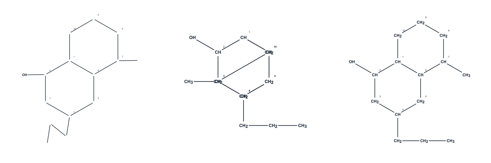

# FIX-SEMI-FUSED-001 — geometría semidesarrollada de anillos fusionados

Fecha: 2026-10-20. Rama: `main`. HEAD inicial y final:
`6e193623d3009df4abc810180822874c242ccfc5` (`fix(aud-nom-011): restore legacy Spanish fused bicyclic names`).

**Resultado:** corrección geométrica y pruebas dirigidas PASS; aceptación visual integral **PARTIAL**, con comprobaciones del editor real pendientes descritas abajo. No se hizo commit, push ni staging.

## A. Diagnóstico reproducido antes de modificar producción

Se creó primero `tests/fix-semi-fused-001-layout.test.mjs` y se ejecutó contra la implementación original: **0 PASS / 1 FAIL**, por vértices coincidentes. No fue un fallo por timeout ni por búsqueda de texto en código.

La estructura mínima procede del constructor real de ciclohexano y `fuseRingOnBond(molecule, 1, 2, 6)`. Sus registros son `[1,2,3,4,5,6]` y `[1,7,8,9,10,2]`, con diez átomos, once enlaces y el enlace compartido 1–2.

Para el caso sustituido se usa el mismo constructor y la colocación real de sustituyentes `placeAttachmentTemplate`: OH en C2, propilo en C4 y metilo en C7. El análisis real, con `detectFunctionalGroups`, confirma `7-metil-4-propilbiciclo[4.4.0]decan-2-ol`, fórmula `C14H26O`. La numeración C1…C10 corresponde a IDs `[1,6,5,4,3,2,10,9,8,7]`.

### Coincidencias confirmadas

Coordenadas anteriores, redondeadas a seis decimales; las diferencias residuales son menores que `1e-7` unidades SVG. Son iguales para el núcleo simple y el núcleo del alcohol de esta fixture.

| IDs distintos | Localizadores del caso sustituido | Coordenadas comunes anteriores (x, y) |
| --- | --- | --- |
| 2 / 7 | C6 / C10 | (122.975607, -71.000000) |
| 3 / 8 | C5 / C9 | (122.975607, 71.000000) |
| 4 / 9 | C4 / C8 | (0.000000, 142.000000) |
| 5 / 10 | C3 / C7 | (-122.975607, 71.000000) |

El enlace 10–2 medía **284**, frente a **142** en los restantes lados del núcleo. Tras la corrección todos los lados del núcleo miden 142 dentro de la tolerancia numérica y desaparecen esas coincidencias.

Las capturas originales no estaban disponibles en el entorno. En esta reproducción los pares sugeridos C2/C8, C1/C5 y C4/C10 están separados aproximadamente **245.951215** unidades antes de la corrección: no se atribuyen a ellos colisiones que no se midieron. Se conserva el detalle completo de coordenadas y distancias en [coordinates.json](fix-semi-fused-001-evidence/coordinates.json).

### Causa raíz confirmada

`placeRingSystems()` en `app/semi-developed-layout.ts`:

1. La distancia mínima desde un centro candidato a los vértices ocupados incluye los dos extremos compartidos. Ambos centros pueden empatar en esa medida; en la reproducción se elegía el centro del primer anillo.
2. `regularRingPositions()` comenzaba en el primer átomo compartido, pero asumía siempre el mismo sentido y no anclaba simultáneamente el otro extremo según su índice real en el segundo anillo. Retener después los extremos originales no reparaba el polígono: dejaba un lado doble de largo y cuatro vértices superpuestos.
3. `sqrt(BOND² − L²/4)` suponía un circunradio `BOND`. Esto sirve para el hexágono de lado `BOND`, pero no da el apotema correcto de un pentágono.
4. Una sola pasada por los registros podía omitir un anillo enumerado antes que el anillo que lo conecta al ya colocado.

## B. Reparación mínima de producción

Solo se modifica **`app/semi-developed-layout.ts`**, en `placeRingSystems()`.

- Se recorre la colección pendiente hasta colocar los anillos conectados, independientemente del orden de registros.
- Se identifica un lado consecutivo del nuevo anillo que ya pertenece a un anillo colocado. Ambos extremos conservan su única posición por ID.
- El centro del anillo padre determina el semiplano ocupado mediante el producto cruzado. El nuevo centro se coloca en el semiplano opuesto.
- Para lado `L` y `N` vértices se utilizan `a = L/(2 tan(π/N))` y `R = L/(2 sin(π/N))`.
- El índice del extremo inicial y el signo del semiplano fijan el ángulo y el sentido de recorrido; el paso siguiente reproduce el segundo extremo compartido. Se calculan únicamente posiciones de los nuevos IDs.

Se reutilizan el layout existente, su escala de 142 unidades y su colocación exterior de sustituyentes. No se introduce un segundo motor ni se cambian fuentes, CSS, tamaño de canvas, enlaces, etiquetas o reglas químicas para disimular la colisión.

Las tolerancias de `1e-7` para lados y vértices y `1e-6` para áreas absorben exclusivamente redondeo trigonométrico. El área esperada es la de un polígono regular, `N·L²/(4 tan(π/N))`; no se escogieron umbrales a partir del dibujo defectuoso.

### Invariantes comprobados

- Comparación profunda del grafo y sus coordenadas originales, IDs, enlaces, anillos y metadatos antes y después del layout.
- Fórmulas y exportaciones canónicas obtenidas con el adaptador real; importación/exportación y documento portable V2 conservan identidad y posiciones reproducibles.
- Mismo análisis sistemático y asociación localizador → ID. No se modifica nomenclatura ni numeración.
- Ciclos completos, áreas regulares, vértices finitos y distintos, lados de longitud uniforme y semiplanos opuestos en las fusiones. Sin cruces de enlaces no relacionados en los casos comprobados.
- Todas las etiquetas y todos los enlaces simples aparecen en el modelo SVG; los enlaces sobreviven al recorte.
- Los píxeles de las etiquetas del componente TSX real se rasterizan con Sharp para medir sus rectángulos: no se superponen entre sí ni son atravesados por segmentos visibles. Se comprueban escalas 75%, 125% y 175%, incluyendo CH/CH₂/CH₃ y OH.
- R/S válidos en C2, C4 y C7, con portadores explícitos hacia OH, propilo y metilo. Se comprueba la configuración absoluta al decodificar cuñas/rayados sin utilizar la paridad almacenada, en posiciones esqueléticas y semidesarrolladas, también reflejadas. La configuración almacenada y el SMILES no cambian.

El estado R/S de la fixture es R/S/R, asignado mediante la API real; no pretende reproducir configuraciones de las capturas ausentes.

## C. Resultados por estructura

PASS en esta tabla significa comprobación automática del modelo/layout/fixture de renderizado. No equivale a aceptación de todas las interacciones de la interfaz.

| Estructura | Fórmula | Geometría | Etiquetas rasterizadas | Conectividad visual de la fixture | Estereoquímica | Identidad | Numeración |
| --- | --- | --- | --- | --- | --- | --- | --- |
| 5+5 | C8H14 | PASS | PASS | PASS | PARTIAL¹ | PASS | PASS² |
| 5+6 y 6+5 | C9H16 | PASS | PASS | PASS | PARTIAL¹ | PASS | PASS² |
| 6+6 | C10H18 | PASS | PASS | PASS | PARTIAL¹ | PASS | PASS² |
| Tres anillos: 6+6+6, 6+6+5 y 6+5+6 | C14H24 / C13H22 | PASS | PASS | PASS | PARTIAL¹ | PASS | PASS² |
| 6+6 con OH, propilo y metilo | C14H26O | PASS | PASS | PASS | PASS³ | PASS | PASS² |

1. No se asignaron configuraciones a las fixtures sin estereoquímica explícita; se conserva su estado original. No se afirma que se probaran todas las configuraciones de esas familias.
2. Se comprueba el mapeo químico de numeración; la pintura y la interacción de las insignias reales quedan pendientes en UI.
3. PASS de almacenamiento y decodificación geométrica de descriptores. La presentación de cuñas en el editor tiene la limitación indicada abajo.

Se ejercitan registros de anillos invertidos y desordenados, rotaciones cíclicas de sus listas, inversión independiente del sentido de cada anillo, extremos de enlaces intercambiados, IDs remapeados no correlativos, átomos/enlaces reordenados, coordenadas fuente transformadas y reflexión de presentación. Las variantes de listas producen lados compartidos horizontales, verticales y diagonales. No se exige igualdad absoluta de coordenadas entre órdenes distintos: se exige la misma identidad y polígonos geométricamente válidos.

Para el alcohol se verifican C1…C10 como `CH, CH, CH2, CH, CH2, CH, CH, CH2, CH2, CH2`; OH en C2, CH₂–CH₂–CH₃ en C4 y CH₃ en C7.

## D. Evidencia y límites de inspección visual

[Comparación del núcleo](fix-semi-fused-001-evidence/core-comparison.png) y [comparación del alcohol](fix-semi-fused-001-evidence/alcohol-comparison.png): izquierda esquelética, centro semidesarrollada anterior, derecha corregida.



Se inspeccionaron esas comparaciones, además de `alcohol-320-light.png` y `alcohol-390-dark.png`. Los dos anillos y los sustituyentes son distinguibles en la salida corregida. Se generaron también SVG/PNG a 1280, 390 y 320 px en claro y oscuro.

**Procedencia:** las imágenes son fixtures estáticas que ejecutan los layouts de producción, `buildSemiDevelopedRenderModel`, `SemiDevelopedAtomSvg` real y el recorte real de enlaces. El pequeño ensamblador de escena usa Arial como fuente de respaldo y los tamaños CSS correspondientes a estas estructuras. La vista esquelética visualiza las posiciones del layout real y omite las etiquetas de carbono. No se ha copiado ni sustituido el algoritmo defectuoso para inventar una ilustración. La versión anterior se carga directamente del objeto Git de HEAD inicial, sin sobrescribir producción.

**No son capturas del editor completo.** La composición de numeración de las imágenes es ilustrativa y sigue el mapeo real, pero no ejecuta el posicionador de insignias del editor. No se certifica la métrica de Inter descargada por el navegador, ni el layout responsivo de toda la aplicación a partir de estos PNG.

### Cobertura de acciones y pendientes

| Ruta | Evidencia efectiva | Estado |
| --- | --- | --- |
| Esquelética → semidesarrollada → esquelética y operación inversa | Cálculos repetidos, identidad profunda y determinismo en las fixtures | PASS de funciones; UI manual pendiente |
| Reflejo/redibujado, commit, undo/redo | Suite existente de fusión y direcciones: acciones reales extraídas, snapshots de historial/grafo/fórmula/geometría | PASS del harness; interacción visual manual pendiente |
| Guardar/recuperar | Documento V2 del caso complejo y demás fixtures; suite existente de documentos fusionados | PASS |
| SMILES | Round trips reales de todas las fixtures, incluido alcohol estereoespecífico | PASS |
| SVG/PNG | Generación estática con el componente y geometría de producción, sin recortes de las figuras observadas | PASS de fixtures; botones/exportación del editor pendientes |
| Escritorio, 390/320 px, claro/oscuro | Archivos estáticos generados; inspección parcial indicada arriba | PARTIAL; UI real pendiente |
| Zoom normal y canvas ampliado | No se automatizaron sus controles ni la interacción del navegador | PENDIENTE |
| Condensada | Ruta sin modificar; no se ejecutó una batería completa de esa representación | PENDIENTE en UI |

En `app/page.tsx`, las cuñas/rayados tetraédricos se calculan actualmente solo cuando `viewMode === "skeletal" && stereochemistryEnabled`. Esta condición preexistente no se modificó. Las pruebas verifican que los descriptores calculados para las coordenadas de ambas vistas comunican el R/S correcto, pero **no certifican que la UI semidesarrollada pinte cuñas que actualmente no solicita**. No se amplió el alcance ni se modificó el motor estereoquímico.

No se detectó un nuevo defecto químico ni una inversión de configuración en las pruebas ejecutadas. La aceptación completa de UI requiere los controles manuales anteriores. No se declara la reparación visual integral finalizada basándose solo en apariencia estática.

## E. Validación ejecutada

Todos los procesos Node se lanzaron con límite **externo de 85 segundos** mediante PowerShell `Start-Process`, `WaitForExit(85000)` y `Kill($true)` del árbol si excedían el límite. Los tiempos siguientes son de pared medidos con `Stopwatch`; no se confunden con los tiempos internos de cada aserción.

### Ejecuciones finales

| Comando | Tiempo pared | PASS / FAIL / SKIP | Resultado |
| --- | --- | --- | --- |
| `node --test tests/fix-semi-fused-001-layout.test.mjs` | 41.360 s | 20 / 0 / 0 | PASS |
| `node --test --test-concurrency=1 tests/semi-developed-renderer.test.mjs tests/semi-developed-orthogonal-layout.test.mjs tests/semi-developed-label-scale.test.mjs tests/semi-developed-atom-hit-target.test.mjs` | 11.185 s | 20 / 0 / 0 | PASS |
| `node --test --test-concurrency=1 tests/fused-ring.test.mjs tests/manual-display-direction.test.mjs tests/skeletal-bond-geometry.test.mjs tests/multiple-bond-visual-geometry.test.mjs` | 11.250 s | 44 / 0 / 0 | PASS |
| `npm run build:pages` | 4.907 s | No aplica | PASS, salida 0 |
| `npm run validate:pages` | 0.882 s | No aplica | PASS, 3 entradas, 6 assets, base `/Hydrocarbon-Lab/` |
| `node reports/fix-semi-fused-001-evidence/render.mjs` | 2.522 s | No aplica | PASS, SVG/PNG/JSON regenerados |
| `git diff --check` | Sin cronometraje separado | No aplica | PASS, salida 0 |

**Total de la selección final: 84 PASS / 0 FAIL / 0 SKIP. TIMEOUT: 0.** No se suman repeticiones de la misma prueba para inflar la cobertura.

### Ejecuciones de desarrollo, conservadas explícitamente

- Reproducción previa de un caso: 0/1/0, 0.585 s. Fallo esperado por coincidencias de vértices antes de tocar producción.
- Mismo caso tras reparar el layout: 1/0/0, 0.370 s.
- Primera ampliación a 16 casos: 14/2/0, 2.923 s. Las dos expectativas de nombre usaban el reconocedor del alcohol sin pasarle los grupos funcionales que necesita. Se completó el harness con `detectFunctionalGroups` del motor real; no se modificó producción química.
- Selección de 16 casos, con análisis real: 16/0/0, 12.972 s.
- Selección de 16 casos con decodificación independiente de cuñas y fixture de sustituyentes colocada por la API real: 16/0/0, 9.077 s.
- Primera generación de evidencia: salida 0, 2.555 s; se regeneró para incluir la etiqueta del heteroátomo en la comparación esquelética.
- Finalmente se añadieron 6+6+5, 6+5+6 e inversión independiente de las listas, dando los 20 casos de la ejecución final.

El build advierte de importación simultáneamente estática/dinámica de `openchemlib-adapter.ts` y chunks mayores de 500 kB. No son errores del build y quedan fuera de este cambio. Git avisa de normalización futura LF→CRLF en el archivo de producción; `diff --check` no detecta errores de whitespace.

**No ejecutado:** `npm test`, patrón completo `tests/*.test.mjs`, auditorías masivas/de 440 estructuras, baterías completas de Practice/Exam y suites extensas de UI. Tampoco se instaló ninguna dependencia.

### Reproducción del límite externo (PowerShell)

Ejemplo para la prueba nueva; sustituir únicamente la lista de argumentos por la de cada comando de la tabla. Para npm se lanzó Node con `"C:\Program Files\nodejs\node_modules\npm\bin\npm-cli.js"`, `run` y el nombre del script.

```powershell
$out = Join-Path $env:TEMP ('fixsemi-' + [guid]::NewGuid().ToString('N') + '.out')
$err = Join-Path $env:TEMP ('fixsemi-' + [guid]::NewGuid().ToString('N') + '.err')
$timer = [Diagnostics.Stopwatch]::StartNew()
$p = Start-Process node -ArgumentList @('--test', 'tests/fix-semi-fused-001-layout.test.mjs') -PassThru -NoNewWindow -RedirectStandardOutput $out -RedirectStandardError $err
$timedOut = -not $p.WaitForExit(85000)
if ($timedOut) { $p.Kill($true); $p.WaitForExit() }
$timer.Stop()
Get-Content -LiteralPath $out,$err
Write-Output ('BOUNDED_NODE_SECONDS=' + $timer.Elapsed.TotalSeconds)
if ($timedOut) { Write-Output 'TIMEOUT after 85 seconds'; $code = 124 }
else { $p.Refresh(); $code = $p.ExitCode }
Remove-Item -LiteralPath $out,$err -ErrorAction SilentlyContinue
exit $code
```

## F. Archivos y seguridad Git

### Producción y pruebas

- Modificado: `app/semi-developed-layout.ts`.
- Nuevo: `tests/fix-semi-fused-001-layout.test.mjs`.
- Nuevo: `tests/helpers/semi-fused-fixture.mjs`.
- Nuevo: `reports/fix-semi-fused-001-layout.md` (este informe).

### Evidencia nueva: lista exacta

```text
reports/fix-semi-fused-001-evidence/render.mjs
reports/fix-semi-fused-001-evidence/coordinates.json
reports/fix-semi-fused-001-evidence/core-skeletal.svg
reports/fix-semi-fused-001-evidence/core-skeletal.png
reports/fix-semi-fused-001-evidence/core-before.svg
reports/fix-semi-fused-001-evidence/core-before.png
reports/fix-semi-fused-001-evidence/core-after.svg
reports/fix-semi-fused-001-evidence/core-after.png
reports/fix-semi-fused-001-evidence/core-comparison.png
reports/fix-semi-fused-001-evidence/alcohol-skeletal.svg
reports/fix-semi-fused-001-evidence/alcohol-skeletal.png
reports/fix-semi-fused-001-evidence/alcohol-before.svg
reports/fix-semi-fused-001-evidence/alcohol-before.png
reports/fix-semi-fused-001-evidence/alcohol-after.svg
reports/fix-semi-fused-001-evidence/alcohol-after.png
reports/fix-semi-fused-001-evidence/alcohol-comparison.png
reports/fix-semi-fused-001-evidence/alcohol-320-light.svg
reports/fix-semi-fused-001-evidence/alcohol-320-light.png
reports/fix-semi-fused-001-evidence/alcohol-320-dark.svg
reports/fix-semi-fused-001-evidence/alcohol-320-dark.png
reports/fix-semi-fused-001-evidence/alcohol-390-light.svg
reports/fix-semi-fused-001-evidence/alcohol-390-light.png
reports/fix-semi-fused-001-evidence/alcohol-390-dark.svg
reports/fix-semi-fused-001-evidence/alcohol-390-dark.png
reports/fix-semi-fused-001-evidence/alcohol-1280-light.svg
reports/fix-semi-fused-001-evidence/alcohol-1280-light.png
reports/fix-semi-fused-001-evidence/alcohol-1280-dark.svg
reports/fix-semi-fused-001-evidence/alcohol-1280-dark.png
```

Total: **1 archivo existente modificado y 31 archivos nuevos propios**. Las salidas de `build:pages` permanecen ignoradas.

No se modificaron `fuseRingOnBond()`, `app/page.tsx`, adaptador SMILES, nomenclatura, estereoquímica, Practice/Exam, tests previos ni informes históricos. Los archivos ajenos `reports/orgorush-aud001-repair.md` y `tatus --short` permanecen sin seguimiento y sin editar.

Estado Git al cierre previsto y comprobado tras añadir el informe:

```text
 M app/semi-developed-layout.ts
?? reports/fix-semi-fused-001-evidence/
?? reports/fix-semi-fused-001-layout.md
?? reports/orgorush-aud001-repair.md
?? "tatus --short"
?? tests/fix-semi-fused-001-layout.test.mjs
?? tests/helpers/semi-fused-fixture.mjs
```

Siguiente paso: revisión de los cambios y validación manual de UI enumerada en D; después, la batería integral en CI cuando el usuario decida hacer commit/push.
