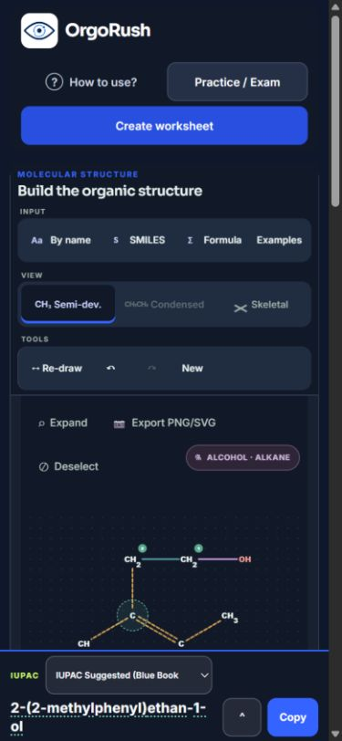

# AUD-NOM-009 — preparación para lanzamiento público de OrgoRush

## A. Resumen ejecutivo

**Auditoría terminada con límites explícitos. Audit-only: ningún cambio de producción ni de pruebas existentes.**

| Evaluación | Resultado | Alcance de la decisión |
|---|---|---|
| TECHNICAL_READINESS | **READY_WITH_LIMITATIONS** | Hay evidencia suficiente para una beta educativa acotada; no para certificar exactitud universal o accesibilidad completa. |
| SHOW_HN_READINESS | **READY_AFTER_FIXES** | Antes de invitar público amplio: traducir el rechazo isotópico, avisar la temporalidad de sesiones, retirar feedback químico obsoleto y facilitar información pública en inglés. |
| PRODUCT_HUNT_READINESS | **READY_AFTER_FIXES** | Mismas correcciones pequeñas; completar beta de principiantes y preparar demostración fiel al alcance. |

**Registro actual: 0 P0, 0 P1, 8 P2 y 2 P3.** No se confirmó un nuevo `CHEMICAL_ERROR` ni un `NOMENCLATURE_ERROR` normativamente adjudicado. Hay dos textos Legacy EN de morfología dudosa ya documentados; su grafía histórica sigue `UNVERIFIED`, no se inventó una expectativa ni se declaró corrupción por un rechazo OPSIN.

Fortalezas actuales: 38/38 grafos importados conservan su identidad completa al exportar; el isótopo se rechaza sin grafo degradado; 126/126 proyecciones pedagógicas disponibles reconstruyen el nombre y tienen referencias válidas. Las reparaciones 006/006B/007/008 siguen observándose en sus controles. En producción se completaron controles mínimos de Practice Naming, MCQ y Build, corrección, Reviewer, Dashboard y un Exam de dos preguntas.

Riesgos principales: menor cobertura de Legacy ES; mensajes de importación/restauración que pueden confundir; pérdida de enlaces del nombre complejo tras recargar; sesiones temporales sin aviso próximo al inicio; documentación pública principalmente española. Son problemas localizados o de comunicación; no se elevan artificialmente a P1.

**Recomendación: iniciar una beta externa de 5–10 personas.** No se encontraron bloqueantes técnicos nuevos que justifiquen abrir otra familia química. Las correcciones editoriales y de presentación listadas como gate de difusión deben preceder al lanzamiento amplio. No se realizó estudio con usuarios reales.

### Baseline y publicación

**Cierre documental AUD-NOM-009B:** los once entregables previstos existen, incluida la matriz generada por el guion. El inventario completo también incluye recibos, capturas y estados AX: no se limita al listado reducido de archivos editados que mostró Codex. Véanse [cierre y staging explícito](aud-nom-009/aud-nom-009b-closure.md) y [verificación documental](aud-nom-009/document-integrity.json). No se repitió la auditoría química. La muestra son **39 entradas congeladas = 38 grafos importados + 1 rechazo isotópico**. Las **126 comprobaciones** designan modelos disponibles de caso/perfil, con varias aserciones cada uno; no 126 moléculas ni un recuento exacto de aserciones individuales.

- Rama `main`; HEAD local y remoto: `63d8a8e7ef1df0ccafa62378fa6ebb2a30a49b31`, AUD-NOM-008.
- [Workflow 39317378866](https://github.com/sciu-lab/Hydrocarbon-Lab/actions/runs/39317378866): `completed / success`, 2026-10-19 20:12:30–20:39:00 UTC. Se verificaron por API sus pasos: regresiones críticas, suite completa, build Pages, validación del artefacto y publicación, todos exitosos. Esto prueba esos gates del commit; no sustituye las observaciones de producto de esta auditoría.
- Las rutas públicas [EN](https://sciu-lab.github.io/Hydrocarbon-Lab/en/) y [ES](https://sciu-lab.github.io/Hydrocarbon-Lab/es/) funcionan en el navegador. Sus títulos y `lang` corresponden al idioma; los arilos modernos de AUD-NOM-008 están visibles en producción.
- Al iniciar no había cambios tracked. Se preservaron `reports/orgorush-aud001-repair.md` y `tatus --short`, ambos sin seguimiento.
- Recibo resumido de API y estado inicial: [baseline.json](aud-nom-009/baseline.json). No se inspeccionó el binario Pages contra un hash embebido de versión; la atribución del despliegue se apoya en el workflow y el comportamiento coincidente observado.

### Calidad y límites de evidencia

**Actual ejecutada:** funciones reales del HEAD, muestra fija, controles dirigidos de evaluación y navegador sobre Pages. **Actual estática:** componentes, almacenamiento, rutas de importación, evaluadores y configuración HTML. **Histórica:** informes RC1, AUD-NOM-005, 006B, 007 y 008; recibos originales OPSIN. **Inferencia:** impacto probable en principiantes, aún sin validación humana.

El navegador tenía almacenamiento previo: no equivale a una primera visita limpia. La muestra es intencional y pequeña; sus proporciones describen cobertura de esta selección, nunca una tasa general de exactitud. No se revisaron todas las dependencias ni se certificó el servidor Sites.

Las comprobaciones de interfaz fueron automatizadas por el agente mediante IAB/CUA, con inspección DOM/AX e interpretación de capturas. No fueron sesiones manuales de usuarios externos. El archivo `en-isotope-error-1280.jpg` conserva contexto de la interfaz inglesa, pero el mensaje de error queda fuera de su viewport: no es prueba visual autónoma de ese texto. El rechazo y su mensaje están registrados en la matriz S38 y en la observación original resumida en `browser-checks.json`; 009B explicita esta limitación sin fabricar otra captura. En 009B se corrigieron las extensiones de nueve capturas JPEG guardadas originalmente como `.png`; se conservaron sus bytes y hashes, y se actualizaron las referencias. El PNG exportado conserva su formato y nombre originales.

## B. Cobertura química y calidad de nomenclatura

### Selección congelada y resultados

[sample-plan.json](aud-nom-009/sample-plan.json) se escribió **antes** de ejecutar salidas actuales: 39 estructuras, incluidas todas las familias mínimas solicitadas y controles de límites. El guion no genera moléculas ni ejecuta el auditor histórico de 440 estructuras. Su SHA-256 está en [smoke-matrix.json](aud-nom-009/smoke-matrix.json), que conserva nombres exactos, análisis, prefijos, grupos, enlaces, fragmentos, explicaciones, IDCode de entrada y resultado de exportación.

| Perfil | Nombre disponible / 38 importadas | Bloqueadas después de importar | MATCH OPSIN de texto exacto EN | Otros nombres disponibles |
|---|---:|---:|---:|---|
| 2013 ES | 37 | 1 | No aplica | 37 sin adjudicación nueva de español |
| 2013 EN | 37 | 1 | 24 | 13 UNVERIFIED |
| 1979 ES | 18 | 20 | No aplica | 18 sin adjudicación nueva de español |
| 1979 EN | 34 | 4 | 14 | 18 UNVERIFIED, 2 REJECTED |

El caso isotópico S38 se rechaza antes de crear el grafo y se cuenta aparte. En total hay **126 nombres disponibles, 26 posiciones bloqueadas en grafos aceptados y 4 posiciones no ejecutables por rechazo de importación**. Las 71 salidas inglesas disponibles tienen 38 MATCH, 31 sin recibo exacto y 2 REJECTED; **0 MISMATCH observados con recibo válido**. Esto no significa que las 126 salidas estén adjudicadas normativamente.

Se reutilizaron recibos originales, validando hash, URL y texto exacto; no se consultó OPSIN de nuevo ni se tradujo el español para fabricar una referencia independiente. MATCH verifica interpretación estructural, **no** preferencia IUPAC. La fórmula por sí sola tampoco demuestra identidad; se comparó el IDCode completo de OpenChemLib, que incorpora conectividad, cargas, isótopos y estereoquímica. Adaptador y comparador comparten toolkit: no son dos motores químicos independientes.

### Matriz exacta

“—” significa nombre no disponible. No significa error químico. Los SMILES identifican cada caso sin depender de la escritura del nombre.

| Caso / SMILES | Fórmula | 2013 ES | 2013 EN | 1979 ES | 1979 EN |
|---|---|---|---|---|---|
| S01 `C` | C₁H₄ | metano | methane | metano | methane |
| S02 `CCCC` | C₄H₁₀ | butano | butane | butano | butane |
| S03 `CCCCCCCCCCCCCCCCCCCCCCCCCCCCCC` | C₃₀H₆₂ | triacontano | triacontane | triacontano | triacontane |
| S04 `CC(C)CC` | C₅H₁₂ | 2-metilbutano | 2-methylbutane | 2-metilbutano | 2-methylbutane |
| S05 `CC(C)(C)C` | C₅H₁₂ | 2,2-dimetilpropano | 2,2-dimethylpropane | 2,2-dimetilpropano | 2,2-dimethylpropane |
| S06 `C=CC` | C₃H₆ | propeno | propene | 1-propeno | 1-propene |
| S07 `CC=CC` | C₄H₈ | but-2-eno | but-2-ene | 2-buteno | 2-butene |
| S08 `C#CC` | C₃H₄ | propino | propyne | 1-propino | 1-propyne |
| S09 `C=CC=C` | C₄H₆ | buta-1,3-dieno | buta-1,3-diene | — | 1,3-butadiene |
| S10 `C1CCCCC1` | C₆H₁₂ | ciclohexano | cyclohexane | — | cyclohexane |
| S11 `CC1CCCCC1` | C₇H₁₄ | metilciclohexano | methylcyclohexane | — | methylcyclohexane |
| S12 `c1ccccc1` | C₆H₆ | benceno | benzene | — | benzene |
| S13 `Cc1ccccc1` | C₇H₈ | metilbenceno | methylbenzene | — | methylbenzene |
| S14 `c1(C=C)ccc(Cl)cc1` | C₈H₇Cl | 1-cloro-4-vinilbenceno | 1-chloro-4-ethenylbenzene | — | 1-chloro-4-vinilbenzene |
| S15 `c1(CCO)c(C)cccc1` | C₉H₁₂O | 2-(2-metilfenil)etan-1-ol | 2-(2-methylphenyl)ethan-1-ol | — | — |
| S16 `c1(CCO)cc(C)ccc1` | C₉H₁₂O | 2-(3-metilfenil)etan-1-ol | 2-(3-methylphenyl)ethan-1-ol | — | — |
| S17 `c1(CCO)ccc(C)cc1` | C₉H₁₂O | 2-(4-metilfenil)etan-1-ol | 2-(4-methylphenyl)ethan-1-ol | — | — |
| S18 `c1(CCO)ccccc1` | C₈H₁₀O | 2-feniletan-1-ol | 2-phenylethan-1-ol | 2-feniletanol | 2-phenylethanol |
| S19 `c1(CCO)c(C)cc(C)cc1` | C₁₀H₁₄O | — | — | — | — |
| S20 `CC(Cl)C` | C₃H₇Cl | 2-cloropropano | 2-chloropropane | 2-cloropropano | 2-chloropropane |
| S21 `CCO` | C₂H₆O | etanol | ethanol | etanol | ethanol |
| S22 `CC(O)CO` | C₃H₈O₂ | propan-1,2-diol | propan-1,2-diol | 1,2-propanodiol | 1,2-propanediol |
| S23 `CCC=O` | C₃H₆O | propanal | propanal | propanal | propanal |
| S24 `CC(=O)C` | C₃H₆O | propan-2-ona | propan-2-one | propanona | propanone |
| S25 `O=C1C=CCCC1` | C₆H₈O | ciclohex-2-en-1-ona | cyclohex-2-en-1-one | 2-ciclohexenona | 2-cyclohexenone |
| S26 `CCC(=O)O` | C₃H₆O₂ | ácido propanoico | propanoic acid | ácido propanoico | propanoic acid |
| S27 `CCOCC` | C₄H₁₀O | etoxietano | ethoxyethane | — | 1-ethoxyethane |
| S28 `CCCCCC(C)OCCCCC` | C₁₂H₂₆O | 2-pentoxiheptano | 2-pentyloxyheptane | — | 2-pentoxiheptane |
| S29 `CC(C)OCCCC` | C₇H₁₆O | 1-(1-metiletoxi)butano | 1-(1-methylethoxy)butane | — | 1-(1-methylethoxy)butane |
| S30 `CC(=O)OCC` | C₄H₈O₂ | etanoato de etilo | ethyl ethanoate | — | ethyl ethanoate |
| S31 `CCN` | C₂H₇N | etanamina | ethanamine | — | ethanamine |
| S32 `CC(=O)N` | C₂H₅NO | etanamida | ethanamide | — | ethanamide |
| S33 `CCC#N` | C₃H₅N | propanonitrilo | propanenitrile | — | propanenitrile |
| S34 `CC[N+](=O)[O-]` | C₂H₅NO₂ | nitroetano | nitroethane | — | 1-nitroethane |
| S35 `CC(=O)CO` | C₃H₆O₂ | 1-hidroxipropan-2-ona | 1-hydroxypropan-2-one | 1-hidroxi-2-propanona | 1-hydroxypropanone |
| S36 `F/C=C/F` | C₂H₂F₂ | (1E)-1,2-difluoroeteno | (1E)-1,2-difluoroethene | — | (1E)-1,2-difluoro-1-ethene |
| S37 `F/C=C\F` | C₂H₂F₂ | (1Z)-1,2-difluoroeteno | (1Z)-1,2-difluoroethene | — | (1Z)-1,2-difluoro-1-ethene |
| S38 `[13CH3]CO` | C2H6O | Rechazo isotópico | Rechazo isotópico | Rechazo isotópico | Rechazo isotópico |
| S39 `C[C@H](O)CC` | C₄H₁₀O | (2S)-butan-2-ol | (2S)-butan-2-ol | (2S)-2-butanol | (2S)-2-butanol |

La fórmula elemental que devuelve OCL para S38 no muestra la masa isotópica; la anotación `[13CH3]` del SMILES es la evidencia isotópica y provoca rechazo explícito. No se exportó como etanol ordinario.

### Interpretación de bloqueos

- **UNSUPPORTED_BY_DESIGN:** S19 (alcohol arilo dimetilado) mantiene bloqueados los cuatro perfiles. AUD-NOM-008 admite solo la subfamilia monometilfenil/etan-1-ol. S15–S17 permanecen bloqueados en ambos perfiles Legacy mientras se adjudica la grafía histórica; no se copió el nombre moderno. S38 mantiene el rechazo isotópico seguro. Estos límites no son defectos de identidad.
- **MISSING_COVERAGE:** de los 20 bloqueos Legacy ES, cuatro corresponden a los límites anteriores; los otros 16 son huecos de familias presentes en el dominio general: S09–S14, S27–S34 y S36–S37. Algunos son controles más complejos, pero ciclohexano, benceno, éter, éster, amina y amida sencillos muestran claramente la diferencia de cobertura. No se adjudicó aquí un texto histórico esperado para cada uno.
- **UNVERIFIED:** S14 y S28 Legacy EN siguen mostrando `1-chloro-4-vinilbenzene` y `2-pentoxiheptane`; los recibos exactos los rechazan. Su morfología mixta es observable, pero un fallo de parser no establece por sí solo un nombre históricamente correcto ni un error de identidad. Son el residuo ya documentado en AUD-NOM-006, **sin regresión de la reparación moderna**.
- **UI_PRESENTATION_ERROR:** los problemas de restauración y feedback son distintos de los nombres del motor. No se los contabiliza como errores químicos del grafo.

### Controles de riesgo y referencias

- Alcanos S01–S05: cuatro perfiles disponibles, incluidos C30 y sustituyentes repetidos; la igualdad entre moderno y Legacy no provoca indisponibilidad. La reparación acíclica AUD-NOM-007 sigue activa.
- S14 moderno EN conserva `1-chloro-4-ethenylbenzene`; S28 conserva `2-pentyloxyheptane`; S29 conserva `1-(1-methylethoxy)butane`. No reaparecieron los defectos 006/006B. La adjudicación moderna precedente está en los informes 006/006B y sus fuentes Blue Book; no se extiende a Legacy.
- S15/S16/S17: tres IDCode distintos, C9H12O, alcohol en cadena C1 y arilo en C2; posiciones internas 2/3/4, con anillo y metilo incluidos en el prefijo. Los nombres modernos ES/EN y su derivación se reutilizan de [AUD-NOM-008](aud-nom-008-aryl-substitution.md): Blue Book P-44.1.1, P-29.6 y P-63.1.2; guía española RSEQ/IUPAC 2021. No se realizó una nueva adjudicación normativa en AUD-NOM-009.
- S25 conserva la insaturación C2=C3 del anillo y la cetona; los cuatro nombres reconstruyen sus fragmentos. S35 elige cetona como función principal y conserva hidroxi como prefijo. El detalle de grupos/localizadores procede del análisis real, no de una mera búsqueda del nombre completo en un párrafo.
- S07 (`CC=CC`) exporta sin inventar configuración; S36/S37 conservan E/Z diferenciados; S39 conserva el centro tetraédrico y muestra (2S). El IDCode completo de entrada/exportación coincide en los 38 grafos aceptados.
- Los 126 modelos reutilizan el análisis del perfil activo; conservan el grafo; todos sus fragmentos son literales y los enlaces reconstruyen exactamente el nombre. Se comprueban destinos, átomos, enlaces tipados y localizadores contra el análisis. Esto verifica consistencia pedagógica, no todas las decisiones normativas posibles de cada párrafo.
- La muestra no cubre exhaustivamente desempates de progenitor, orden de varios sustituyentes distintos ni todas las prioridades combinadas. La evidencia adicional de CI es actual; los inventarios de 440 estructuras y los 45/2/0/4 estados de AUD-NOM-005 se conservan como historia, no se presentan como resultados actuales completos.

## C. Producto educativo

| Módulo | Evidencia actual | Conclusión y límite |
|---|---|---|
| Constructor | Importación válida, rechazo inválido/isotópico, añadir C, eliminar terminal, Undo/Redo, nombre moderno/Legacy y control no admitido; PNG real | Funciona en los controles. La modificación de un enlace SVG mediante el instrumento no se completó: queda pendiente, no es un fallo confirmado del producto. Inserción manual de anillo y selección completa no se repitieron. |
| Practice Naming | Una pregunta Easy/alkane, semilla `aud-nom-009`: ethanol frente a hexane → incorrecta; corrección hexane → correcta | Initial score sigue 0/1; final mastery pasa a 1/1. No se modifica el primer resultado. |
| Practice MCQ | Una pregunta; A. hexane aceptada, score 1/1 | Referencia visual de seis carbonos; textos y selección en inglés. No se midió la generación mixta larga. |
| Practice Build | Objetivo 2-methylpentane; dibujo inicial methane rechazado | Se ejercitó la vía de estructura incorrecta. Aceptación correcta y rechazo constitucional/E/Z se verificaron aparte por el evaluador real, sin barrido. |
| Reviewer / Dashboard | Respuesta original, referencia, idioma, historial de intentos, desglose por tipo/categoría y explicación detallada | Flujos actuales accesibles en los controles; no se dedujo de RC1 que todas las combinaciones funcionen hoy. |
| Exam | Dos preguntas Naming/alkane, navegación y ES→EN, revisión, confirmación y resultados | Borradores conservados en sesión. Sin referencia expuesta en las dos vistas previas al envío; confirmación explícita y sin campo editable después. Reviewer Q1: hexane frente a ethane, rechazo correcto. |
| Class Seed | Dos IDs anónimos con semillas distintas, procesado local y posible solapamiento expresamente indicados | Es reproducibilidad, sin cuentas, entrega remota, identidad docente ni anti-cheat. No se repitieron CSV ni generación química por participante. |

El guion [grading-smoke.mjs](aud-nom-009/grading-smoke.mjs) ejecutó **seis comparaciones fijas**: identidad igual, butano frente a 2-metilpropano (misma fórmula, conectividad distinta), E frente a E, E frente a Z, tipografía española permitida y rechazo de inglés frente a referencia española. Todas pasaron con referencias y envíos estructuralmente válidos. El evaluador compara elementos, conectividad, órdenes, cargas y configuración admitida; no usa solo fórmula o parecido textual.

Naming normaliza tipografía y compara contra el nombre de referencia localizado; **no es un adjudicador general de sinónimos o de todos los nombres IUPAC equivalentes**. Esa política debe acompañar las instrucciones de la beta. No se halló un falso positivo de evaluación en los controles; tampoco se certifica ausencia de falsos negativos fuera de ellos.

Exam es una actividad educativa ejecutada en el cliente. La ocultación previa se refiere a la interfaz observada y al renderer inspeccionado; no es una promesa de supervisión segura ni de resistencia a inspección del cliente. Exam MCQ/Build no se ejecutaron en esta fase.

## D. Experiencia de usuario, bilingüismo, móviles y fiabilidad

### Primera visita y lenguaje

El título inglés y el H1 identifican OrgoRush. “Build the organic structure”, las entradas By name/SMILES/Formula/Examples y los pasos Select → Add → Analyze ofrecen una secuencia concreta. “How to use?” abre una guía de siete pasos; se observó el primer paso, con instrucciones de seleccionar carbono y añadir C. Practice/Exam está visible y su configuración separa temas, tipos y dificultad. La comprensión real por un principiante sigue pendiente: la sesión del navegador tenía una molécula anterior y decisiones de guía guardadas.

EN se revisó en constructor, configuraciones, feedback, resultados, Reviewer, Class Seed, exportación y Settings. No se encontró una fuga general de español en esos controles; sí el error isotópico (`UNTRANSLATED`) y el residuo léxico Legacy descrito. La diferencia de cobertura entre idiomas no es por sí sola una traducción química incorrecta. El README usa el nombre antiguo y sus instrucciones de producto/privacidad están sobre todo en español (`INCONSISTENT` / `AMBIGUOUS` de presentación).

### Móvil y accesibilidad

| Vista observada | Ancho pedido | clientWidth / scrollWidth | Resultado acotado |
|---|---:|---:|---|
| Main, escritorio | 1280 | 1265 / 1265 | Sin overflow horizontal global |
| Main, arilo largo, oscuro | 390 | 375 / 375 | Nombre se parte en líneas, Copy visible |
| Main, arilo largo, oscuro | 320 | 305 / 305 | Nombre y controles principales utilizables; desplazamiento vertical considerable |
| Reviewer, claro | 320 | 305 / 305 | Sin overflow global observado |
| Exam Reviewer, claro | 390 | 375 / 375 | Sin overflow global observado |

La diferencia de 15 px corresponde al espacio de scrollbar en este navegador. El problema RC1 MOBILE-001 de unos 17 px en el dock de Main a 320 **no se reprodujo en estos estados**; no se cierra universalmente con una sola molécula. RC1 también registró favicon, dependencias y coste de MCQ: no se reejecutaron esos diagnósticos ni se presentan como defectos nuevos confirmados.

Se observaron etiquetas en campos y botones, resultados con texto además de color, controles de accesibilidad opcional y un foco visible azul de 3 px en Confirm submission; Tab y Return completaron ese envío. Settings con SMILES abierto requiere atender AUD009-008: Escape procesa primero el panel de fondo. El botón Close permanece etiquetado.

La legibilidad visual en claro/oscuro de las vistas indicadas fue razonable. **No se midió cuantitativamente contraste, no se ejecutó axe, no se hizo recorrido completo de teclado, lector de pantalla real ni hardware táctil.** La etiqueta “AA high contrast” de un ajuste no es evidencia de conformidad WCAG.



### Persistencia y presentación

- SMILES inválido `C1CC`: error explícito en inglés. Isótopo: rechazo seguro; mensaje español pendiente de localización. El intento fallido mantuvo la molécula inicial ethanol y el recuento de History. La ruta de archivo llama al mismo adaptador; no se ejecutó una carga de archivo.
- S19: grafo válido, mensaje “Local IUPAC name unavailable for this structure” y Copy deshabilitado; no se presenta un nombre reducido como correcto.
- Un draft arilo sobrevivió al reload con mismo nombre/fórmula; pierde enlaces pedagógicos por `sourceNameOverride` de nombres entre paréntesis. El código de restauración y la compuerta de enlaces explican AUD009-004.
- Se recuperó ethanol ya existente desde History. La biblioteca Saved estaba y sigue vacía; no se fabricó un PASS de guardar/restaurar Saved ni de .quimica. Esas vías tienen evidencia histórica/CI, con verificación manual actual pendiente.
- La restauración desde History no limpia la confirmación SMILES anterior: queda “Suggested IUPAC name: butane” junto a ethanol/C2H6O (AUD009-007). El nombre activo y grafo están bien; el mensaje obsoleto debe invalidarse.
- Practice/Exam y Dashboard viven en estado temporal de componentes, como documenta README. No se añadió almacenamiento remoto. La falta de aviso junto a Start es el hallazgo, no la política temporal en sí. No se recargó deliberadamente un examen activo para afirmar una prueba de persistencia que no se hizo.
- Copy: UI confirmó la acción, pero el lector del portapapeles de sesión devolvió vacío. Sin resolver la frontera con el portapapeles nativo, el resultado de copiado real es **UNVERIFIED**, sin etiquetarlo como PASS o defecto confirmado.
- PNG real descargado y abierto visualmente: 70.281 bytes, anillo, metilo y cadena alcohólica completos. [exported-aryl.png](aud-nom-009/exported-aryl.png). SVG: opción visible y código existente; descarga nueva pendiente.
- Rutas directas ES/EN y ancla de explicación funcionan. Un ancla comparte una vista, no la molécula o la sesión. No se encontró ni se asumió un sistema de URL molecular compartida.
- El almacenamiento es local en Pages, no sincronización entre dispositivos. El HTML incluye Google Analytics; el resolver de contexto puede consultar servicios cuando hay nombre/identidad visible. Se observaron fichas externas de ethanol/propane sin una búsqueda manual. OPSIN/PubChem/Wikidata/Wikipedia y Analytics deben explicarse sin prometer ausencia de terceros u operación totalmente offline. No se realizó una evaluación legal de consentimiento.

Las observaciones y límites por flujo están en [browser-checks.json](aud-nom-009/browser-checks.json); los `.txt` son capturas AX completas de estados concretos. El navegador produjo cuatro entradas nuevas de History de diagnóstico; no se borraron las dos anteriores. Saved permaneció en 0, se recuperó ethanol y se restauraron tema automático y viewport por defecto. Una descarga PNG permanece también en Downloads.

## E. Preparación pública y materiales de lanzamiento

### Presentación y documentación

La descripción propuesta es fiel al alcance observado:

> Free interactive organic chemistry lab for building molecules, learning IUPAC nomenclature, and practicing with instant feedback.

Conviene añadir inmediatamente que la cobertura es delimitada y que los perfiles Legacy pueden no estar disponibles. “Free” describe acceso público observado; no implica garantía de precio permanente ni derechos sobre el código.

| Elemento | Estado actual |
|---|---|
| OrgoRush, título/description EN/ES, enlaces públicos | Presentes y coherentes en la aplicación |
| README | Describe funciones y límites con honestidad, pero abre con Hydrocarbon Lab y español; mezcla extensa documentación del scaffold Sites |
| Canal de errores | Plantilla GitHub Issues disponible; no se observó acceso directo desde el laboratorio |
| Privacidad/servicios/persistencia | README lo explica principalmente en español; falta entrada fácilmente descubrible desde EN |
| Licencia | Ningún LICENSE tracked; README lo reconoce. Acceso gratuito y código visible no otorgan por sí solos permisos de código abierto |
| Demostración de lanzamiento | No se identificó material específico de Show HN/PH con los nombres consultados en el repositorio; no prueba ausencia de material privado externo |

No recomendar una licencia comercial ni otorgar permisos no autorizados. Si el propietario decide publicar una licencia, debe decidir sus términos; hasta entonces comunicar simplemente “free to use” y “code available”, sin “open source”.

### Recomendaciones de materiales, sin producir piezas definitivas

- **Video 20–40 s:** 0–5 s: qué es y para quién; 5–15 s: construir una molécula sencilla y pulsar un fragmento del nombre; 15–27 s: respuesta equivocada → feedback → corrección; 27–35 s: Exam con envío explícito y resultados; cierre con /en/ y una frase de cobertura limitada. No mostrarlo como examen supervisado.
- **Tres capturas:** (1) constructor inglés con nombre interactivo y estructura legibles; (2) Practice con feedback y explicación; (3) resultados/Reviewer mostrando separación entre puntuación inicial y correcciones. Priorizar desktop limpio; añadir móvil solo como material suplementario.
- **Enfoque de descripción Show HN:** herramienta educativa gratuita, construcción y explicación de nombres, sesiones reproducibles; pedir ejemplos concretos que rompan el flujo. Enlazar directamente /en/ y límites.
- **Enfoque Product Hunt:** aprendizaje visual, feedback inmediato y uso en clase mediante semillas; explicar que el progreso de sesiones es temporal. Publicar después de observar la beta.
- **Primer comentario del creador:** motivación docente, autoría, tecnología a alto nivel, familias/perfiles admitidos, tres límites concretos, qué información incluir al reportar errores y qué feedback se busca.
- **FAQ prevista:** ¿qué diferencia hay entre 2013 y Legacy?, ¿se admiten todos los nombres equivalentes?, ¿por qué una estructura no tiene nombre?, ¿se guarda el resultado?, ¿hay cuentas o seguimiento docente?, ¿qué sale a servicios externos?, ¿puedo usarlo sin red?, ¿qué permisos tiene el código?

Estas son pautas editoriales; no se generaron imágenes publicitarias, videos ni posts finales.

## F. Registro de hallazgos

Cada entrada del [registro JSON](aud-nom-009/issue-register.json) contiene pasos, impacto, evidencia actual, confianza, módulo, recomendación mínima, coste y gate. La confianza es alta sobre las observaciones; en AUD009-005 la grafía normativa histórica se declara expresamente no verificada.

| ID | Prioridad | Hallazgo | Clasificación | Coste relativo | Gate de difusión |
|---|---|---|---|---|---|
| AUD009-001 | P2 | El rechazo isotópico aparece en español en /en/ | UI_PRESENTATION_ERROR | bajo | Ambos |
| AUD009-002 | P2 | Falta cobertura Legacy ES para familias sencillas dentro del dominio general | MISSING_COVERAGE | medio (documentación: bajo) | Ninguno |
| AUD009-003 | P2 | La pérdida de sesión al recargar se explica en README pero no junto al inicio de la actividad | UI_PRESENTATION_ERROR | bajo | Ambos |
| AUD009-004 | P2 | Recargar un nombre local con sustituyente entre paréntesis elimina sus enlaces pedagógicos | UI_PRESENTATION_ERROR | medio | Ninguno |
| AUD009-005 | P2 | Dos salidas Legacy EN siguen mezclando morfología española | UNVERIFIED | medio | Ninguno |
| AUD009-006 | P2 | Falta una entrada pública breve en inglés a límites, privacidad y reporte de errores | UI_PRESENTATION_ERROR | bajo | Ambos |
| AUD009-007 | P2 | Al recuperar History queda visible la confirmación SMILES de otra molécula | UI_PRESENTATION_ERROR | bajo | Ambos |
| AUD009-008 | P2 | Escape atiende el panel de fondo antes que el diálogo Settings | UI_PRESENTATION_ERROR | bajo | Ninguno |
| AUD009-009 | P3 | README sigue encabezado Hydrocarbon Lab mientras la aplicación se llama OrgoRush | UI_PRESENTATION_ERROR | bajo | Ninguno |
| AUD009-010 | P3 | El texto de alcance aún dice nueve familias funcionales | UI_PRESENTATION_ERROR | bajo | Ninguno |

Los gates de difusión de P2 son decisiones prácticas de preparación, **no P1 encubiertos**. La aplicación sigue siendo utilizable para una beta. La menor cobertura Legacy, los arilos bloqueados por seguridad y la ausencia de cuentas no se convierten en corrupción, fraude o fallos funcionales inventados. P0/P1 históricos de RC1 no se arrastran como abiertos si la evidencia actual no los reproduce.

## G. Recomendaciones y propuesta AUD-NOM-010

### Secuencia mínima

1. **Antes de difusión amplia:** AUD009-001 (localización), AUD009-007 (feedback vinculado al grafo activo), AUD009-003 (aviso temporal) y AUD009-006 (entrada pública inglesa con límites, terceros y Issues). Son cambios pequeños y revisables; añadir controles dirigidos de los estados concretos, sin refactorización.
2. **Siguiente prioridad educativa:** AUD009-004 (restauración de interacción) y AUD009-008 (Escape del overlay activo). Mantener las protecciones contra nombres externos y evidencia incorrecta.
3. **Legacy:** documentar ahora la cobertura; adjudicar después los dos textos ingleses inciertos antes de cambiarlos. Ampliar Legacy ES solo cuando el uso observado lo justifique, con reglas y controles propios.
4. **Puede esperar:** alineación cosmética README, texto de recuento de familias, más capturas promocionales y nuevas familias. No hacen falta cuentas, sincronización, arquitectura nueva ni otra auditoría de 440 moléculas para esta decisión.
5. **Verificaciones cortas pendientes antes de afirmar soporte pleno:** portapapeles real, SVG descargado, guardar/restaurar .quimica/Saved, edición SVG de enlaces en un navegador manual, Exam MCQ/Build, lector de pantalla y dispositivo táctil. Conservar sus estados UNVERIFIED hasta completarlas.

**AUD-NOM-010 propuesto:** una reparación acotada de presentación y preparación de beta, empezando por los cuatro gates anteriores y siguiendo con la restauración/teclado. Si aparece un P0/P1 reproducible, pasa primero. No elegir otra familia química anticipadamente ni reabrir 006/008 sin regresión.

### Beta futura de 5–10 personas

Invitar estudiantes principiantes y 1–2 docentes, con sesiones breves observadas y sin datos personales en semillas. Sin ayuda inicial: describir qué creen que hace OrgoRush, construir una molécula sencilla, identificar su nombre y abrir una explicación, completar una actividad Practice y explicar el feedback. Después: navegar dos preguntas Exam y enviar; volver al laboratorio; describir qué creen que se guarda. Probar al menos dos participantes en teléfono y uno con teclado.

Registrar éxito sin asistencia, puntos de bloqueo, interpretación del feedback, expectativas de persistencia, errores químicos mínimos con SMILES/perfil/idioma/semilla y voluntad de volver. No imponer una nota porcentual arbitraria: cualquier pérdida de identidad, evaluación errónea confirmada o flujo principal imposible exige reparación; las confusiones repetidas deben corregirse antes de Product Hunt. Esto es **trabajo futuro**, no una beta realizada.

## H. Evidencia, comandos y alcance de validación

### Ejecuciones locales nuevas

Todos los procesos Node iniciados para diagnóstico se ejecutaron mediante [run-bounded.ps1](aud-nom-009/run-bounded.ps1): `WaitForExit(85000)` y `Kill(true)` del árbol al vencer, sin usar `--test-timeout` como sustituto. No hubo TIMEOUT de Node ni suites costosas simultáneas.

Desde la raíz:

```powershell
& ./reports/naming-audit/aud-nom-009/run-bounded.ps1 -NodeArgs @('reports/naming-audit/aud-nom-009/smoke.mjs')
& ./reports/naming-audit/aud-nom-009/run-bounded.ps1 -NodeArgs @('reports/naming-audit/aud-nom-009/grading-smoke.mjs')
& ./reports/naming-audit/aud-nom-009/run-bounded.ps1 -NodeArgs @('reports/naming-audit/aud-nom-009/summarize.mjs')
```

| Comprobación | Resultado | Tiempo real externo |
|---|---|---:|
| Muestra congelada, motor real | 39 casos; 38 identidades/38 inmutabilidades PASS; 126 reasoning PASS; rechazo seguro S38 | 16,40 s (motor 14,79 s) |
| Seis comparaciones del evaluador | 6 PASS | 22,48 s |
| Resumen de datos ya capturados | PASS; sin volver a ejecutar química | 0,16 s |
| Validación de artefactos de auditoría | PASS; ver [validation.json](aud-nom-009/validation.json) | 0,37 s |
| `git diff --check` | PASS en el árbol tracked; también se comprueba whitespace de nuevos textos con el validador | Comando breve |

Las lecturas Git/`rg`/`Get-Content` fueron breves, sin procesos persistentes. Hubo búsquedas exploratorias con glob de PowerShell/rutas inexistentes que devolvieron errores de descubrimiento; se corrigieron las rutas y no sustentan ningún PASS de producto.

El navegador usó el proceso ya abierto, sin servidor local ni otro proceso Node iniciado por la auditoría. Una llamada de descarga demoró **208,7 s** en la mediación de navegador/archivo, pese a pedir timeout del evento; no se pudo imponer desde esa API un límite externo al navegador existente. Se registra esta excepción instrumental al presupuesto de espera, sin convertirla en benchmark de OrgoRush ni repetir otras descargas. El archivo se obtuvo y abrió visualmente. Las acciones de enlace SVG no completadas y el portapapeles vacío quedan declarados como límites, no como pruebas aprobadas.

### Pages y CI

**Build Pages y validate:pages: PASS en el CI correspondiente exactamente a HEAD**, ver baseline y workflow enlazados. No se repitieron localmente: no cambió producción, dependencias, configuración ni pruebas, y el encargo prioriza evidencia vigente sin repetir baterías. La suite completa también pasó allí; no se extrajo un recuento de tests de sus logs, por lo que no se inventa uno.

**No ejecutado localmente:** `npm test`, glob global de tests, auditor de 440 estructuras, instalación/actualización de dependencias, carga, barridos amplios de Practice/Exam, build completo Sites, nueva auditoría de dependencias, nueva adjudicación normativa general ni consultas OPSIN masivas. Tampoco se hicieron pruebas reales con usuarios, lector de pantalla, teléfonos físicos, Excel ni certificación WCAG.

### Fuentes revisadas

- README; `docs/release-hardening-rc1.md` (histórico; no certificación actual); `.github/workflows/deploy-pages.yml`; plantilla de Issues; HTML de Pages ES/EN.
- Informes AUD-NOM-005, 006B, 007 y 008; informe 006 para alcance residual Legacy; sus referencias no se alteraron.
- `app/page.tsx`: importación/commit/restauración, nombre activo/copiado, sourceNameOverride, atajos y contexto externo.
- Adaptador OCL, convenciones, evaluadores de respuestas/referencia/estructura, sesiones y paneles Practice/Exam, Class Seed, guía y estilos.
- Helpers reales de `tests/helpers/exercise-chemistry.mjs`, `reasoning-integrity.mjs`, `reference-corpus.mjs`; proyección `scripts/naming-audit/evaluate.mjs` y validador de recibos `evidence.mjs`.
- Recibos originales: `tests/reference-corpus/opsin-snapshots.json`, `opsin-evidence.json`, `aud-nom-003-opsin-evidence.json`, `aud-nom-005/sample-opsin-evidence.json`, `aud-nom-005/rule-derived-candidate-receipts.json`, `aud-nom-008/opsin-receipts.json`.
- Capturas actuales, AX, métricas y límites en `aud-nom-009/`. La instantánea visual no equivale a probar cada control o viewport con cada molécula.

### Archivos y Git

Únicas altas de esta intervención: este informe y `reports/naming-audit/aud-nom-009/` (registro, matriz, selección congelada, evidencia de navegador, scripts mínimos y validación). **Ningún archivo tracked de producción, pruebas existentes, corpus, recibos históricos o documentación anterior fue modificado.** Los dos archivos ajenos sin seguimiento siguen preservados. Se mantiene rama/HEAD; **sin commit ni push**.
